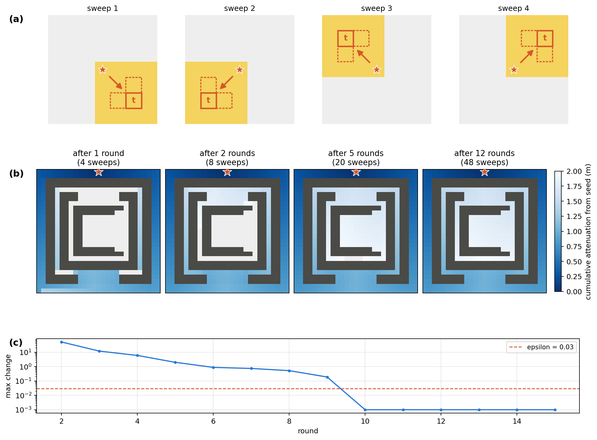

# GFM - Global Flood Model

GFM maps coastal flood hazard and exposure worldwide. It extends the Aqueduct coastal-flooding
method (Deltares) to a global tile grid: for each coastal DeltaDTM tile it prepares elevation,
land/water mask, friction and storm-tide boundary inputs, solves a friction-weighted eikonal
equation (fast-sweeping method) for flood depth per return period and sea-level-rise level,
merges the tiles into 5-degree chunks, and derives population exposure, adaptation pathways and
validation scores against national flood maps. A separate sub-pipeline calibrates the eikonal
friction against the hydrodynamic model SFINCS.



## What it produces

| Output | Resolution | Location (`<data_root>` = `paths.root`) |
|---|---|---|
| Flood depth per tile and per 5° chunk | ~30 m (1 arcsec, DeltaDTM grid) | `<data_root>/model_outputs/`, `<data_root>/merged_results/chunks/` |
| Flood fraction on the population grid | ~1 km (30 arcsec) | `<data_root>/merged_results/chunks/flood_fraction/` |
| Exposed population and expected annual impact | country / WRI geographic unit | `<data_root>/merged_results/exposure/` |
| Adaptation pathways, tipping points, figures | country / continent / global | `<data_root>/figures/` |
| Validation scores (HR, FAR, CSI, bias) | per benchmark region | `<data_root>/validation/` |

Scenarios: return periods 2, 5, 10, 25, 50, 100, 250, 500 and 1000 years; sea-level-rise levels
0, 0.5, 1.0, 1.5 and 2.0 m on top of present-day storm tide (COAST-RP), with spatial fingerprints
from the IPCC AR6 projections (`boundary_conditions.slr_projection`, default SSP2-4.5).
Population change follows the SSP projections to 2100.

## Quick start

The pipeline reads the input datasets listed in [docs/data.md](docs/data.md) from one data root
(several TB for the global grid, needed in full even for the smallest scenario). There is no
bundled sample data; the unit tests run without data. Commands are bash (Git Bash on Windows,
see [docs/install.md](docs/install.md)).

```
git clone <repo_url> gfm && cd gfm
conda env create -f environment.yml          # creates the `gfm` env
conda activate gfm
cp snakemake_workflow/config/config_local.yml.example snakemake_workflow/config/config_local.yml
#   set paths.root (<data_root>) and paths.code_root (this checkout)
pytest -m "not needs_data"                   # checks the install, no data needed
```

With the data in place, the smallest real scenario is the Bangkok / Chao Phraya case study
(9 tiles, all return periods and sea-level-rise levels). The sequence, with the hop-by-hop
simulate commands and the exposure and plot scripts, is
[docs/running.md §4](docs/running.md#4-bangkok--chao-phraya-case-study):

```
python preparation/run_preparation.py        # global inputs, once
printf '%s\n' 1026 1048 1092 1194 1195 1199 3930 3933 3943 > bangkok_tile_ids.txt
python preparation/build_tile_subset_by_id.py --tile-ids-file bangkok_tile_ids.txt \
    --out <data_root>/processed_inputs/mask/bangkok_chao_phraya_tiles.gpkg
python snakemake_workflow/scripts/materialize_configs.py bangkok_chao_phraya
export GFM_CONFIG_PATH=snakemake_workflow/config/bangkok_chao_phraya_materialized.yml
snakemake preprocess --cores 3 --resources mem_mb=8000
snakemake simulate --cores 3                 # hop-0 tiles must finish first: rerun until complete
snakemake postprocess --cores 3
python analysis/compute_bangkok_case_exposure.py --config $GFM_CONFIG_PATH \
    --case-polygon-gpkg <data_root>/bangkok_chao_phraya/bangkok_chao_phraya_domain.gpkg
```

The full global grid runs on a SLURM cluster: [docs/hpc.md](docs/hpc.md).

## Repository layout

| Directory | Contents |
|---|---|
| `src/` | shared library: tiling, eikonal solver, merging, exposure, validation |
| `preparation/` | global inputs: tile grid, boundary conditions, DeltaDTM mosaics |
| `snakemake_workflow/` | Snakemake rules and scripts, configs, HPC job generators |
| `analysis/` | exposure, adaptation pathways, figures, delta case study |
| `validation/` | comparison with national flood maps and the SF Bay benchmark |
| `sfincs_tiles/` | SFINCS calibration of the eikonal friction (cluster) |
| `calibration_studies/` | solver sensitivity studies (sweep budget, obstacle coupling) |
| `tests/` | pytest suites |
| `docs/` | methods, data, install, running and HPC guides |
| `profiles/` | Snakemake profile loaded by default |
| repository root | `run_eikonal_dag.py`, `run_delta_floodmaps.py`, `check_*_progress.py`, `run_bangkok_case_study.bat` ([docs/running.md](docs/running.md)) |

## Configuration

Settings are layered; later files override earlier ones:

1. `snakemake_workflow/config/config.yml`: every pipeline setting (tracked).
2. `config_local.yml`: this machine's `paths.root` and `paths.code_root` (gitignored; copy the
   `.example`).
3. `<scenario>.yml` plus `<scenario>_pins.yml` (values a scenario's existing outputs were
   computed with), merged into `<scenario>_materialized.yml` by
   `snakemake_workflow/scripts/materialize_configs.py` and selected with `GFM_CONFIG_PATH`.
4. On a cluster: `config_hpc.yml` (gitignored; copy `config_hpc.example.yml`) holds the cluster
   paths, partitions and environment activation; the SFINCS calibration also needs
   `sfincs_tiles/site_env.sh` (copy `site_env.example.sh`). See [docs/hpc.md](docs/hpc.md).

`profiles/default/config.yaml` makes Snakemake re-run a job only when its inputs, parameters or
software environment change, not when a script is edited.

## Documentation

- [docs/install.md](docs/install.md): environments (`gfm`, `hydromt-sfincs-dev`) and tests
- [docs/data.md](docs/data.md): input datasets, versions, sources, licences and access
- [docs/running.md](docs/running.md): preparation, the Snakemake DAG, analysis, validation
- [docs/hpc.md](docs/hpc.md): running on a SLURM cluster
- Methods: [tile processing and water levels](docs/methods_01_tile_processing_and_waterlevels.md),
  [flood depth](docs/methods_02_flood_depth.md),
  [calibration sensitivity](docs/methods_03_calibration_sensitivity.md),
  [SFINCS validation](docs/methods_04a_SFINCSvalidation.md),
  [national map validation](docs/methods_04b_MapsValidation.md)
- [CONTRIBUTING.md](CONTRIBUTING.md), [CITATION.cff](CITATION.cff), [LICENSE](LICENSE)

## Citation and licence

Cite the software with [CITATION.cff](CITATION.cff); a DOI will be added at the first release.

The code is released under the [MIT licence](LICENSE). Documentation, figures and model outputs
are licensed under [CC BY 4.0](https://creativecommons.org/licenses/by/4.0/). Input datasets
keep their own licences ([docs/data.md](docs/data.md)).
