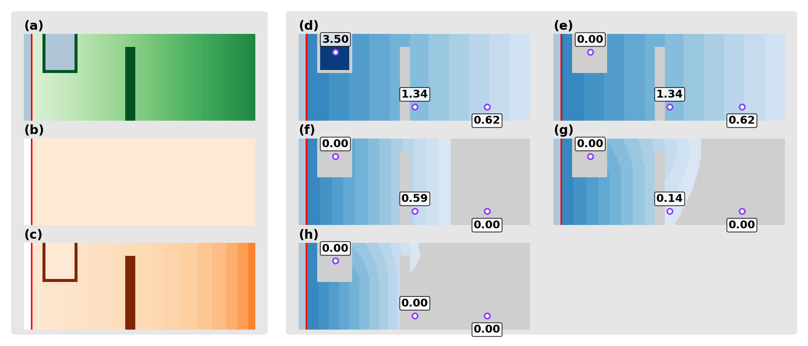
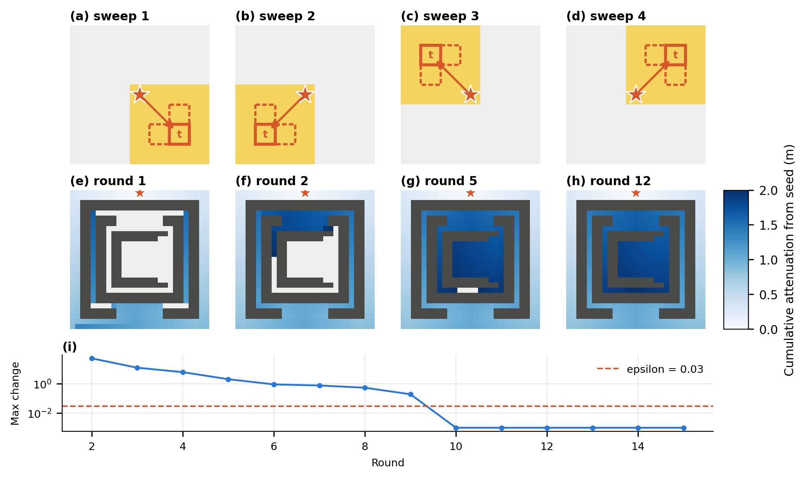
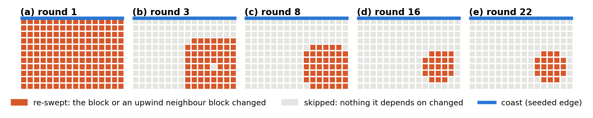
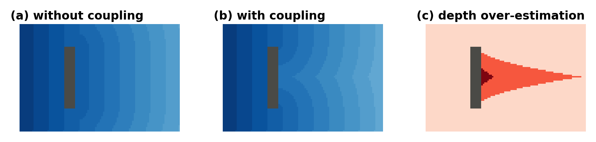

# Method: Friction-Weighted Eikonal Propagation for Coastal Flood Depth Estimation

## 1. Overview

Coastal flood hazard (extent and depth) is estimated for each raster tile and
scenario (a return period of extreme still water level, optionally combined
with a sea-level-rise increment) from three static raster inputs — a digital
elevation model (DEM), a land/ocean/lake mask, and a land-cover-indexed
attenuation rate — together with a set of discrete
boundary water-level points describing the offshore forcing for that
scenario. Rather than solving the full time-dependent shallow-water equations
at every grid cell, the model treats inland flood propagation as a
**static, boundary-value problem governed by the eikonal equation**, with the
land-cover-indexed attenuation rate acting as a spatially varying
propagation cost. This formulation is solved numerically with the Fast Sweeping
Method (Zhao, 2005), giving a flood water level (and
hence depth) at every cell in a single, non-iterative-in-time pass per
scenario. Simpler models from the same seeds - a bathtub, a connected
bathtub and a straight-line attenuation - and a uniform instead of a
land-cover rate are selectable for comparison (`simulation.flooding.model`,
`friction_source`; `src/flood_variants.py`, calibrated against SFINCS in
methods_04a). 

## 2. Conceptual basis

### 2.1 The eikonal-propagation analogy

Instead, the model reframes inland flood propagation as an anisotropic
**cost-distance / geodesic-distance problem**, formally identical to the
eikonal equation used to describe wavefront propagation in geometric optics
and seismic first-arrival travel-time computation:

$$
|\nabla T(x)| = v(x), \qquad x \in \Omega
$$

with $T$ prescribed on a seed set $\Gamma$ (the coastline). Here $v(x) > 0$
is a spatially varying "slowness" field — in this application, the
land-cover-indexed attenuation rate (§2.2) — and $T(x)$ is
interpreted as the (negative) water level rather than a physical travel
time (see §4.4). The physical intuition is direct: floodwater advancing
inland preferentially follows the path of least resistance, and the
water level attained at any point is controlled by the *cumulative
frictional head loss* along the least-resistive connected path from the
coast, not by straight-line (Euclidean) distance or by elevation alone.

### 2.2 A land-cover-indexed attenuation rate

$v(x)$ is an empirical attenuation rate: the water-level loss per metre of
inland travel, indexed by land cover. It is not a hydraulic roughness, and
the model never evaluates a Manning-type flow law. "Friction" in the code
and config names means this rate. Its relative values per land-cover class
(Copernicus Global Land Cover LC100, 100 m) are taken from a land-cover
roughness table: $v(x) = n(x)/100$ with $n$ the table's Manning's
coefficient. The table only orders and spaces the classes; the absolute
rate is set by calibration against SFINCS (`friction_scale_factor`, below).
Cells with no assigned land-cover class get `default_friction: 0.002`
($n = 0.2$ in table terms).

Whether the land-cover indexing earns its complexity was tested against a
single uniform rate (review_critiques/calibration_experiments.py). On 498
random SFINCS tiles (RP100), each at its best rate, the two are within 0.005
pooled CSI, with and without the duration correction (§2.4); the land-cover
index is kept for its spatial realism.

**Units.** $v(x) = n(x)/100$ is a per-metre attenuation rate (head loss per
metre travelled), and the solver works in metres: each tile's cell width and
height come from its own grid, as tile means (`rasters.grid_spacing_m`). On
DeltaDTM's 1″ grid a cell is ~30.9 m tall and $30.9\cos\varphi$ m wide at
latitude $\varphi$ (15 m at 61°), so a degree grid is solved on rectangular
cells (§4.4) and the rate needs no grid correction.

`simulation.flooding.friction_scale_factor` multiplies the land-cover rate at
runtime (`src/eikonal_runner.py`), so it can be calibrated without
recomputing the land-cover raster. It is fitted against SFINCS (RP100) by
maximising pooled CSI, with the eikonal solved on SFINCS's 30 m UTM subgrid.
Without the duration correction (§2.4) the friction-sweep study
(`calibration_studies/`, `sfincs_tiles/` friction-sweep tooling;
`<data_root>/calibration_roughness_SFINCS/friction_sweep_pooled_metrics.csv`,
1000 tiles) gives `friction_scale_factor = 0.4` (CSI 0.743, bias 1.05 vs CSI
0.732, bias 1.21 at 0.3). The duration correction raises the rate where events
are short, so the base rate must drop: with it, 498 random tiles give the
production value **`friction_scale_factor = 0.25`** (CSI 0.763, bias 1.08;
0.757, bias 0.98 at 0.3; 0.710 at 0.4; review_critiques/calibration_experiments.py
`--stage representative`). The resulting base attenuation rate is
`n(x) × 2.5` m/km before the duration multiplier, against the ~0.1-1.2 m/km
reported for comparable land cover by Vafeidis et al. (2019).

### 2.3 Two-component sea-level propagation

`simulation.flooding.slr_propagation: two_component` (default). A static sea level
$S$ = MDT + SLR fingerprint (no tide) is not attenuated: every land cell below $S$
that connects to the coastline (or the hop>=1 seeds) through such cells is
permanently inundated and becomes part of the sea. Each gets the seed value
max($S$, level of its nearest original coastline seed), so only the storm tide on
top of $S$ attenuates inland of the new shoreline, and a coast keeps its own
storm tide instead of spreading the highest coastal level over the new sea. Rivers
and lakes do not carry $S$ inland. `attenuated` attenuates the total level
(storm tide + MDT + SLR) from the present coastline, as Aqueduct.
Implementation: `flood_model.static_inundation`, `flood_depth_dense(static_level=)`,
station values from `boundaries.static_station_levels`.

### 2.4 Duration correction

The eikonal level is the peak of a quasi-static fill and ignores how long the
storm tide lasts. Behind a sill, water stands above the controlling elevation only
while the hydrograph is near its peak, so the eikonal fill overstates such basins.
`simulation.flooding.duration_correction` (default on) solves twice. From the first
solve, each wet cell's head above its spill level (priority flood from the sea,
Barnes et al. 2014) gives the time $T$ that the local COAST-HG RP100 storm-tide
hydrograph stays within that head of its peak. The attenuation rate is multiplied
by $(T_\mathrm{ref}/T)^\alpha$, capped at 10 with no lower bound, with $\alpha = 1$
and $T_\mathrm{ref} = 12$ h, and the tile is solved again: brief overtopping gets more
friction, long-standing water less. On 540 synthetic 1-D SFINCS floodplains this
$T^{-\alpha}$ form fits flood extent best, with $T_\mathrm{ref}$ absorbed into
`friction_scale_factor` (`boundary_test/duration_refit.py`). COAST-HG has
one shape per station (RP100), used for every return period and SLR level.
Implementation: `event_volume.DurationCorrection`.

### 2.5 Illustrative comparison of the four variants

Figure 1 runs every entry of `FLOOD_MODELS` on one synthetic scenario
(`docs/figure_scripts/generate_flood_variant_examples.py`), arranged as a 3x3 grid of
panels (one cell unused), styled per the general CLAUDE.md's section 9 via
`analysis/_figure_style.py`: no titles, each panel numbered (a)-(h) just outside its
top-left corner (`panel_letters`), a 180 mm final width set once and never rescaled,
and the full description - what each panel, colour and marker means - lives in the
companion `flood_variant_comparison.txt` (`write_caption`), not on the image itself.
Saved as both PNG (300 dpi) and PDF (fonts embedded) via `_figure_style.save_figure`.
Elevation (a) uses Greens, flood depth (d)-(h) uses Blues, friction (b)/(c) uses
Oranges - single-hue, colour-blind-safe sequential ramps, one fixed per variable in
`_figure_style.py` (section 9 allows these alongside viridis/cividis/Crameri/cmocean
for a single magnitude variable per panel). Land/water context colours
(not part of either scale) reuse `_figure_style.LAND_COLOR`/`WATER_COLOR`, the same
convention as the flood-extent agreement maps. `SHOW_COLORBARS` is an explicit,
documented override (`False` here) of section 9's default of one shared colour bar per
panel group: depth is read off discrete 0.20 m colour bands plus three annotated sample
points instead, which already give exact numbers without crowding eight small panels;
setting it `True` restores the default. Point labels are black text on a white box,
close to their marker; "near"/"far" sit far enough apart, and their labels offset in
opposite directions (above/below), that they never collide despite sharing a row.

A filled light-grey panel (no label, no edge) separates the two groups: panels
(a)-(c), the scenario's static inputs, on the left; panels (d)-(h), every
flood-depth result on that scenario, on the right - with deliberately more
horizontal gap between the two groups than between panels within a group. Within
that, panels (a)-(c) are lettered top to bottom and (d)-(h) left to right, top to
bottom - the usual reading order. A red line in every panel marks the offshore
boundary-forcing column, at elevation 0.

Panels (a) elevation and (b) friction are the scenario's two static inputs: a
floodplain sloping from 0 m at the coast to 2.3 m at the domain's far inland edge, a
pond below sea level (-1 m) walled off on three sides by a closed ring at 3 m (above
the surge peak everywhere around it) and open on the fourth, where the domain's own
upper edge already closes it - it has no coastline anywhere in the domain, not merely
none nearby - and a sill, at the same 3 m, blocking every direct route to the far side
of the domain except around a gap at one end, so the real connected path to a point
there is longer than the straight-line distance to it; friction is spatially uniform.
(A sill closer to the surge peak itself, e.g. ~1.2-1.7 m above the sloping background
rather than safely above it, was tried first and dropped - see
`build_variant_scenario`'s docstring for why it didn't reliably force the detour this
figure needs.)

Panels (d)/(e)/(f)/(g) compare the four variants on that scenario, with no duration
correction. `straight_line` and `eikonal` share the exact same uniform attenuation
rate - only the distance metric they attenuate by differs:

- `bathtub` (d) checks only (IDW-interpolated) level against elevation, with no
  connectivity check, and floods the walled-off pond anyway (3.50 m);
  `bathtub_connected` (e)'s coast-connectivity filter (§4.5) excludes it (0.00 m).
- `straight_line` (f) attenuates the boundary level by the straight-line distance
  through the sill's gap (0.59 m near the gap, 0.00 m far from it); `eikonal` (g)
  attenuates by the true, longer, connectivity-respecting path around the sill, and
  comes out noticeably drier near the gap (0.14 m) - the real path costs more
  attenuation than the straight-line shortcut gives it credit for.

Panels (c)/(h) are deliberately **not** production's actual duration correction
(`event_volume.DurationCorrection`, §2.4): that mechanism needs a first eikonal
pass's own depth to define a head above each cell's spill level, which this panel's
whole point is to not assume. Instead (`elevation_duration_multiplier`), (c) compares
the boundary forcing's time series directly against each cell's own elevation - how
long the forcing alone exceeds it - with no first solve at all. Raised while building
this figure and logged as an open methods question in `TODO.md`, not asserted as the
better algorithm: changing production to work this way would affect the calibrated
`friction_scale_factor`/`duration_refit.py` values (§2.2/§2.4), so it needs a
deliberate decision, not a silent code change. `straight_line` has no spatial friction
field to correct, so a duration correction for it would only ever be a scalar
rescaling of its one `attenuation_m_per_m` - not a meaningful panel, so it is left out
here (that scalar rescaling is still what `flood_depth_dense` itself falls back to
when reporting duration correction's effect in aggregate,
`diagnostics["mean_duration_multiplier"]`, just not reproduced in this figure).

The reference duration (`DURATION_T_REF_S`) is the longest duration any cell in the
domain can see - the full storm - not some shorter, arbitrary value. That pins the
multiplier to exactly 1.0 at the longest-duration (always-wet, coastal) cells and
above 1.0 everywhere else, so the corrected friction is never below the uncorrected
baseline anywhere, and corrected depth can therefore only shrink or stay the same
relative to (g), never exceed it (an earlier version used a fixed 12 h reference,
which gave coastal cells *less* friction than baseline and let corrected depths
exceed the uncorrected ones - backwards, and fixed here). The pond's wall and the
sill (3 m) sit above the 2.5 m surge peak everywhere, so they are never exceeded at
all - they are hard obstacles for (f)/(g)'s connectivity/detour test, not
"briefly-overtopped sills"; the short-but-nonzero-exceedance story this correction is
meant to show instead comes from the open background slope itself (0 m to 2.3 m, all
within reach of the 2.5 m peak), which gives every background cell a real, finite
exceedance duration - long near the coast, short near the inland edge - with no
barrier needed. Because the multiplier is a direct function of elevation alone, (c)'s
pattern is literally the elevation panel's own contours, rescaled - the pond's wall
and the sill read as the same raised (never-exceeded, highest-multiplier) shapes in
both. `eikonal`'s corrected depth (h) (0.00 m near the gap, down from 0.14 m
uncorrected) runs this modified friction field through a single ordinary solve.

## 3. Data inputs

| Symbol | Description | Source |
|---|---|---|
| $z(x)$ | Land surface elevation | DEM, land cells only (see §4.1) |
| $\mathrm{mask}(x)$ | Land / ocean / lake classification | Land-water mask raster |
| $v(x)$ | Land-cover-indexed attenuation rate (water-level loss per metre) | Copernicus LC100 land cover; class values from a land-cover roughness table, scaled by calibration |
| $\{(p_i, H_i)\}$ | Discrete boundary water levels at offshore/coastal points $p_i$, for the scenario (return period × SLR) being run | Offshore/coastal boundary-condition model output |

## 4. Mathematical formulation

### 4.1 Pre-processing

- **Effective elevation**: elevation at non-land cells (ocean, permanent
  water) is set to $0$ (a common reference datum), which does not matter for the solver.
- **Coastline seed set** $\Gamma$: ocean cells directly adjacent (3×3
  dilation of the land mask) to land — i.e. the immediate offshore fringe
  from which inland propagation is seeded using inverse-distance-squared weighting of the 15 nearest Coast-RP stations.
- **Friction floor**: $v(x)$ is floored at a small positive value to avoid
  degenerate (zero-cost, infinite-speed) propagation at any cell.

### 4.2 Governing equation

Define the state variable $T(x) = -H(x)$, the negative of the (to be
determined) flood water level. $T$ satisfies the eikonal equation

$$
|\nabla T(x)| = v(x), \qquad x \in \Omega \setminus \Gamma
$$

$$
T(x_c) = -H_0(x_c), \qquad x_c \in \Gamma
$$

solved over the **entire** raster domain $\Omega$ (land, ocean, and lake
cells alike — see §4.6 on why ocean is not excluded).

The viscosity solution of this equation is not a plain distance transform
from $\Gamma$ (which would be zero on $\Gamma$ itself); each seed point
carries its own prescribed value $T(\gamma(0))$, generally nonzero and
different from seed to seed, and $T(x)$ is the minimum, over every seed and
every path from it, of that seed's own value plus the friction-weighted
geodesic (cost) distance from it to $x$:

$$
T(x) = \min_{\gamma:\, \Gamma \to x} \left[ T\big(\gamma(0)\big) +
\int_{\gamma} v(s)\, ds \right]
$$

i.e., in terms of the physical water level,

$$
H(x) = \max_{\gamma:\, \Gamma \to x} \left[ H_0\big(\gamma(0)\big) -
\int_{\gamma} v(s)\, ds \right]
$$

**the propagated water level at any point equals the boundary water level
at the best-connected coastline seed, minus the minimal cumulative
frictional head loss along the least-resistive path connecting them.**
This is the precise sense in which floodwater is modelled as following the
path of least resistance, and in which land-cover-driven resistance
attenuates inland water levels with (friction-weighted) distance from the
coast.

### 4.4 Numerical solution: the Fast Sweeping Method

The eikonal equation is solved on the raster grid using the Fast Sweeping
Method (Zhao, 2005), a Gauss–Seidel-type scheme that avoids
the need for a priority queue (as in Fast Marching) at the cost of
repeated grid sweeps.

**Grid staggering.** $T$ is defined on the grid *vertices*, one larger in
each dimension than the friction/elevation *cell* grid (an $(m+1)\times
(n+1)$ vertex array for an $m \times n$ cell array) — each vertex update
draws on exactly one corner cell's friction value and its two orthogonal
vertex neighbours.

**Local update.** Write $t := T$ at the vertex currently being updated, and
$t_a$, $t_b$ for $T$ at its two "upwind" neighbouring vertices (already
updated earlier in the current sweep): $t_a$ the row-neighbour, a cell height
$\Delta y$ away, and $t_b$ the column-neighbour, a cell width $\Delta x$ away
(see "Grid staggering" above). With local friction $f$ (per metre) at the one
corner cell this update draws on, the first-order upwind discretisation of
the eikonal equation is

$$
\left(\frac{t - t_a}{\Delta y}\right)^2 + \left(\frac{t - t_b}{\Delta x}\right)^2 = f^2 .
$$

With $v = f\,\Delta y$ and $r = \Delta y / \Delta x$ its causal solution is

$$
t = \frac{t_a + r^2 t_b + \sqrt{(1 + r^2)\,v^2 - r^2 (t_a - t_b)^2}}{1 + r^2},
$$

accepted only when the discriminant is non-negative and $t > \max(t_a, t_b)$;
otherwise the scheme falls back to the one-sided update
$t = \min(t_a + f\,\Delta y,\; t_b + f\,\Delta x)$. On square cells ($r = 1$)
this is the familiar $t = \tfrac12\big(t_a + t_b + \sqrt{2v^2 - (t_a - t_b)^2}\big)$.
The discriminant is written as a difference of two small terms rather than of
two large squares, which keeps the float32 solve accurate. The vertex value is
updated only if the computed candidate improves on (is smaller than) its
current value — i.e., a standard Gauss–Seidel relaxation toward the eikonal
solution of §4.3.

**Sweep ordering.** Each full iteration visits the grid in all four
combinations of ascending/descending row and column traversal order ("the
four orthants" of the 2-D Gray-code sweep sequence), so that information
can propagate in every direction regardless of raster storage order —
each direction uses the correspondingly-oriented pair of neighbours and
corner cell.

**Convergence.** Sweeps are grouped into **rounds** of 4 (one full pass in
each of the four sweep directions); a round stops the solve early once the
maximum per-cell water-level change across that round falls below a fixed
tolerance $\varepsilon = 0.03\,\mathrm{m}$ (`waterlevel_epsilon_m`,
configurable), a value chosen to sit well below the $0.10\,\mathrm{m}$
threshold at which a cell's flooded/dry classification is actually decided
(§4.5), rather than chasing numerical precision beyond what is
decision-relevant.

The solve is capped at `max_rounds` if convergence is not reached first. A
fixed, uniform sweep count (e.g. 3) was found to under-converge on larger/geometrically complex
tiles, so a round-based, convergence-checked scheme is the production
default instead, with the original fixed-count mode retained as an optional
non-default configuration. The round cap itself was set empirically: a
calibration exercise across a representative sample of 537 wet real coastal
domains found that 58.5% of domains fully converge (every cell's potential
change drops to/below $\varepsilon$) within 40 rounds, and of the remaining
domains that have not strictly converged by round 40, 97.8% already have a
stable flood extent by then - the residual change is confined to depth
still settling in already-flooded cells, not the flooded/dry boundary
itself. Production therefore caps the solve at `max_rounds = 40` with land-cover friction
(10 with uniform attenuation, from the same study per friction source). See
`methods_03_calibration_sensitivity.md` §2 for the full calibration
methodology.

**Illustrative example.** Figure 2 is generated directly from the
production solver code (`docs/figure_scripts/generate_eikonal_solver_examples.py`).
Panel (a) shows the four sweeps that make up one round, run individually
from a single seed at the centre of a small (deliberately coarse, for
legibility) grid: each mini-panel is the real output of one sweep (one
call to `_dense_sweep`) started fresh from that seed, so the shaded
quadrant (yellow, to avoid the "blue = flooded" association panel (b)
uses) is exactly the set of cells that one sweep alone can reach - not
an illustration. A single seed is used only for this panel's clarity; a
real solve seeds every coastline cell at once, and by the second sweep
onward a cell can also be updated from another cell a previous sweep just
set, not only from the original seed. The arrow points from the seed
toward one highlighted example cell $t$ (solid box), giving the sweep's
general direction; its two "upwind" neighbours (one row-, one column-
neighbour) are outlined too (dashed boxes) and are what that cell's own
update actually reads from, consistent with the local update rule in
the "Local update" section
above - every vertex, including ones on the domain's outer edge, always
has both such neighbours available, since the padded $(m{+}1)\times(n{+}1)$
$t$-grid is sized precisely so row/column indices never run out of bounds;
a neighbour the relaxation hasn't reached yet simply still holds its
placeholder value and is naturally outcompeted in the update, not treated
as a special case. The sweep order itself is a fixed row/column scan per
direction (see the table above), not an expanding wavefront that visits
"easy" (fewer-neighbour) cells first. Panel (b) applies all four sweeps,
round after round, to a harder synthetic case (not a real tile) designed
to need several rounds: a single source point seeded outside a
nested-square-ring maze with alternating gaps, forcing the true shortest
path to spiral inward, reversing direction repeatedly - a known slow case
for a fixed sweep order, since each round only relays information once
along each direction. The colour scale is the cumulative attenuation from
the seed, rescaled to a 0-2m display range for readability (darker =
closer/less attenuated) - the maze's own friction units are otherwise
arbitrary, so this mirrors, rather than reproduces, a real flood depth
scale, in the same sense as a flood water level decaying with distance
from its source. After
1 round only the outer ring is filled in; the solution keeps improving
through round ~9, after which the per-round maximum change drops to zero
(full convergence, panel (c)).

Each of the 4 sweeps making up a round is diagonal, not cardinal: it visits
every cell in a fixed row/column order and updates it from one already-
visited row-neighbour and one already-visited column-neighbour, so a single
sweep can relay information efficiently along any path that doesn't reverse
direction relative to that sweep's own diagonal (e.g. simultaneously moving
up and to the left). This is why, after just 1 round, values already reach
some cells far from the source (the annulus running alongside the maze's
outer wall, reached along a single up-and-sideways diagonal from the gate)
while a cell directly next to the gate can still be unresolved: the local
update rule only ever looks at 2 specific neighbours per sweep, not a true
shortest-path search, so it does not update every cell along even a short
path uniformly within one round - ironing out that unevenness is exactly
what the remaining rounds do.

**Computational implementation.** Two implementation choices make the solver
substantially faster without changing its result in any way: every vertex
value is bit-for-bit identical to a plain implementation of the sweeps
described above (`tests/eikonal_kernel_validation`).

1. *Memory-order traversal and skipped no-op updates.* Within one sweep, a
   vertex reads only its two upwind neighbours, so any traversal order that
   visits both of them first produces exactly the same values. The sweeps
   therefore run row by row, matching the row-major layout of the raster
   arrays. In addition, the local
   update is skipped whenever $\min(t_a, t_b)$ is already no smaller than the
   vertex's current value: every candidate the update can produce is at
   least $\min(t_a, t_b)$, so no improvement is possible. This avoids the
   square root for every unreached, blocked or already-settled vertex.
2. *Block skipping.* The vertex grid is divided into $64 \times 64$ blocks,
   and the solver records, for each block, the last sweep in which any of its
   values changed and, per sweep direction, the last sweep that processed it.
   One sweep direction is idempotent: repeating it with unchanged inputs
   changes nothing. A block's inputs in a given direction are its own values
   plus its upwind neighbour block in the row direction and in the column
   direction (e.g. the blocks above and to the left for the top-left to
   bottom-right sweep), and friction is fixed within a solve. A block is
   therefore skipped if none of those three blocks has changed since it was
   last processed in the same direction. Blocks are visited in the sweep's
   own direction, so every vertex's upwind neighbours are still updated
   before the vertex itself. Because most of a domain settles within the
   first few rounds, and later rounds only move a narrow front through
   winding channels, most block visits are skipped (Figure 3).

On ten real calibration tiles (2–72 million cells), the first change alone
made the complete obstacle-coupled flood solve (§4.4a) 2–7 times faster, and
block skipping made it a further 1.2–5.8 times faster. Typically only 4–30% of
block visits are processed. The gain is largest on tiles that need many
rounds: one tile needing 100 rounds in its first outer iteration went from
354 s to about 9 s. Both changes alter only how much work the solver does,
not what it computes, so neither affects the convergence criterion, the round
cap or any calibration result.

Figure 3 is generated from the production `_block_sweep` code
(`docs/figure_scripts/generate_eikonal_solver_examples.py`) on a synthetic domain (not a real
tile): uniform open land seeded along its top edge (the "coastline"), with
one spiral maze of impassable walls in the lower right, the same construction
as Figure 2b, built at a larger size. A block size of 16 is used for legibility
(production uses 64 on grids roughly 30 times larger in each dimension).
The figure shows only the block grid, not the solution itself: each square
is one block, coloured if it is re-swept in at least one of that round's four
sweeps (because it or an upwind neighbour block changed) and grey if it is
skipped for the whole round (nothing it depends on changed). The titles give
the share of individual block visits (blocks × 4 sweeps) that are processed.
Most of the open land settles after the first round, and by round 8 only the
blocks in and around the maze are still re-swept, while the front keeps
winding through it for 26 rounds. Over the whole solve, 19% of the plain
sweep's block visits are processed, and the script asserts that the result is
identical both to the production solver and to plain dense sweeps.

### 4.4a Structural correction: obstacle coupling

The Fast Sweeping scheme in §4.4 shares a known structural weakness with
cost-distance flood models generally (identified by Kasmalkar et al., 2024): unlike a strictly
monotonic, elevation-aware front-tracking method (e.g. Dijkstra/breadth-first
search on a cost graph), Gauss–Seidel relaxation gives no per-step guarantee
that a cell's value, once updated, respects elevation along the path that
produced it. A friction-cheap route that happens to cross terrain higher
than the water level realistically attenuated to at that point can still
propagate an illegitimately high potential value to cells beyond it — there
is no safe intermediate point during the sweeping process to check elevation
against the still-converging solution.

**Mitigation: an outer iterative loop, enabled by default in production.**
Rather than accepting this risk, the solver optionally (default: on) wraps
the single solve of §4.4 in an outer loop that identifies and blocks cells
that cannot legitimately be on a real flood path, then re-solves:

1. **Static pre-filter** (exact, no iteration cost): any cell whose
   effective ground elevation exceeds the highest prescribed boundary water
   level anywhere in the tile can never legitimately flood, under any
   friction field or path — friction only ever attenuates the propagated
   water level, it never amplifies it above its source value. Such cells are
   assigned a prohibitively high friction value from the start. The open sea
   (ocean components reaching the tile edge or holding a seed) is blocked in
   every solve regardless, so seeds stay local: at the water class's low
   friction a basin's highest seed would otherwise cross the sea and raise the
   lower seeds (they are not frozen) and the land behind them (Bay of Fundy:
   19 m seeds reached the 4.5 m shore 60-80 km away at 12 m). Coastline cells
   stay passable at the friction of their roughest land/river neighbour, so a
   seed enters land, and travels along the coast, at land cost.
2. **Iterative dynamic filter**: solve (§4.4, to the same convergence
   criterion), then additionally block any cell whose resulting
   (locally-attenuated) water level does not exceed its own elevation — such
   a cell cannot legitimately be part of a real flood path either, since a
   real flood path by definition floods every cell along it — and re-solve
   with the newly-blocked cells' friction also raised. This repeats until
   the number of newly-blocked cells in an iteration falls below a small
   tolerance (percent of tile cells), or a maximum iteration count is
   reached.

Because raising a cell's friction can only lower or hold every eikonal
solution value elsewhere in the tile (never raise one), the set of blocked
cells is designed to only grow from one outer iteration to the next,
guaranteeing termination in a finite number of iterations. This correction
changes only which friction values the solver sees; it never changes which
cells participate in the solve.

That monotonicity guarantee must be enforced explicitly, not merely
assumed: an implementation that recomputes the blocked-cell set from
scratch each outer iteration (rather than accumulating it as the union with
every previous iteration's own blocked set) can let a cell blocked in one
iteration appear "unblocked" in the next, once other cells' fresh blocking
reroutes the flow around it - production accumulates the blocked-cell set
as a running union across iterations for exactly this reason. Without that
accumulation, calibration runs on real domains showed that most domains
that failed to converge were instead caught in a
stable, undamped two-state oscillation between alternating blocked-cell
configurations, never settling regardless of how many outer iterations were
allowed.

With the accumulation in place, every one of the 500 calibration domains
converges, the large majority within a handful of outer iterations: the
single largest group (370, 74.0%) reaches convergence at the earliest
mathematically possible outer iteration (iteration 2 - the stopping check
needs a previous iteration to compare against, so it cannot fire any
earlier), almost all of the remainder (123, 24.6%) at iteration 3, and a
small number (7, 1.4%) at iteration 4 - no domain in this
calibration needed more than that. Production caps the outer loop at
`max_outer_iterations = 4`, covering every domain in the calibration.
See
`methods_03_calibration_sensitivity.md` §3 for the full calibration
methodology and exact per-tile breakdown.

**Illustrative example.** Figure 4 shows this on a small synthetic case (not
a real tile): a ridge that is too tall to ever legitimately flood, but
whose low friction makes it numerically the cheapest inland route for the
rows directly behind it - cheaper than the honest detour around it via the
open flanks above and below. Without obstacle coupling, this inflates
reported depth in a band directly behind the ridge (up to ~0.25 m in this
example) relative to the flank rows, which have no such shortcut available;
with obstacle coupling, the ridge is detected and blocked, and depth in
that band drops to what the honest detour alone would produce. Generated
directly from the production solver code
(`docs/figure_scripts/generate_eikonal_solver_examples.py`).

### 4.5 Flood classification and depth

A cell is classified as flooded if the propagated water level exceeds the
local ground elevation, excluding permanent open water:

$$
\mathrm{flood}(x) = \big[ H(x) > z(x) \big] \ \wedge\ \big[\mathrm{mask}(x) \ne \text{ocean}\big]
$$

An additional **hydraulic connectivity filter** is then applied: only
8-connected components of $\mathrm{flood}(x)$ that touch the (dilated)
coastline are retained; any flooded region not reachable via a
continuously-flooded path back to the sea is discarded. This removes
elevation/propagation artefacts — cells that numerically satisfy the
threshold in isolation but have no physically connected inundation pathway
to the coast (e.g. below-threshold interior depressions).

Final flood depth is

$$
d(x) = \begin{cases} H(x) - z(x), & \mathrm{flood}(x) = \text{true} \\ 0, & \text{otherwise} \end{cases}
$$

### 4.6 Domain completeness

The eikonal equation is solved over the entire tile — land, ocean, and
lake cells together — rather than a restricted candidate subset. Ocean
cells (uniformly low friction) provide legitimate hydraulic shortcuts
connecting otherwise-separated stretches of coastline (e.g. around a
headland or across a bay); excluding them from the solve domain would
sever these connections and understate inland water levels near such
features.

## 5. Implementation and validation **[optional section — include if a reproducibility/provenance statement is wanted]**

The solver is covered by unit tests on synthetic grids
(`tests/eikonal_kernel_validation`): from a point source with uniform
friction on cells half as wide as tall, the solution equals $f$ times the
metric distance along both axes and is within the first-order scheme's few
percent of it off-axis; on square cells the update reduces to the classic
two-sided formula; the block-skipping solver is bit-for-bit identical to plain
dense sweeps for square and rectangular cells. The round-based convergence
scheme and the §4.4a obstacle-coupling correction rest on the
convergence/monotonicity arguments given in §4.4/§4.4a and the real-tile
comparisons cited there.

---

*
Kasmalkar, I., Wagenaar, D., Bill-Weilandt, A., Choong, J., Manimaran, S., Lim, T. N., ... & Lallemant, D. (2024). Flow-tub model: A modified bathtub flood model with hydraulic connectivity and path-based attenuation. MethodsX, 12, 102524. https://doi.org/10.1016/j.mex.2023.102524

Vafeidis, Athanasios T., Mark Schuerch, Claudia Wolff, Tom Spencer, Jan L. Merkens, Jochen Hinkel, Daniel Lincke, Sally Brown, and Robert J. Nicholls. "Water-level attenuation in global-scale assessments of exposure to coastal flooding: a sensitivity analysis." Natural Hazards and Earth System Sciences 19, no. 5 (2019): 973-984. https://doi.org/10.5194/nhess-19-973-2019

Zhao, H. (2005). A fast sweeping method for eikonal equations. Mathematics of computation, 74(250), 603-627. https://doi.org/10.1090/S0025-5718-04-01678-3
*
